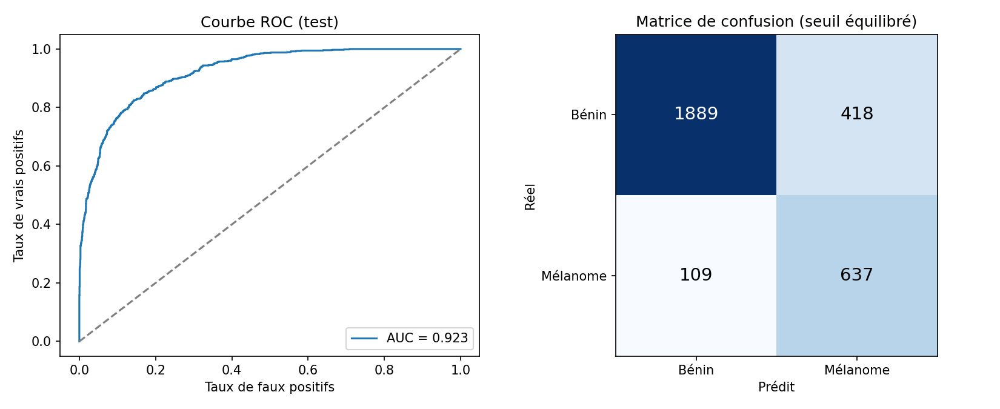

# 🔬 MelanoScan

**Dépister le mélanome en une photo.** MelanoScan est une application web qui estime, à partir d'une
image dermoscopique d'un grain de beauté, la probabilité qu'il s'agisse d'un mélanome, et montre les
zones de l'image qui ont guidé la décision de l'IA.

> Projet du cours *AI for Business* (Advanced AI Algorithms). Ce n'est pas un dispositif médical.

## Pourquoi

Le mélanome est le cancer de la peau le plus mortel, mais il se guérit dans plus de 90 % des cas
lorsqu'il est détecté tôt. Les délais pour voir un dermatologue dépassent souvent plusieurs mois.
Un outil de pré-tri permet de prioriser les lésions suspectes et d'aider les médecins généralistes.

## Résultats

Modèle évalué sur 3 053 images de test (746 mélanomes) de patients jamais vus pendant l'entraînement.
Entraînement : 12 époques en 15 min sur Kaggle (GPU T4).

**AUC test : 0,923**

| Seuil | Accuracy | Accuracy équilibrée | Sensibilité (mélanomes détectés) | Spécificité | Faux positifs | Faux négatifs |
|---|---|---|---|---|---|---|
| Dépistage (0,31) | 81,9 % | 83,4 % | 86,3 % | 80,4 % | 452 | 102 |
| Équilibré, Youden (0,33) | 82,7 % | 83,6 % | 85,4 % | 81,9 % | 418 | 109 |
| Haute confiance (0,50) | 86,9 % | 83,3 % | 76,3 % | 90,3 % | 224 | 177 |

L'application affiche 🟢 sous 0,31, 🟠 entre 0,31 et 0,50 et 🔴 au-dessus de 0,50.
Ancien modèle (EfficientNetB0 100x100) : 83 % d'accuracy, 74 % de sensibilité. MelanoScan détecte donc
plus de mélanomes (86 % contre 74 %) à accuracy égale, sur un jeu de test plus difficile et sans fuite entre patients.



## Ce qui a changé par rapport au projet de départ

| | Projet de départ | MelanoScan |
|---|---|---|
| Données | ~6 000 images ISIC | ISIC 2019 + ISIC 2020 en 256x256 (datasets Kaggle de Chris Deotte), détectés automatiquement |
| Modèle | EfficientNetB0, 100x100 | ResNet-50 (ImageNet), 256x256 |
| Découpage | aléatoire par image | par patient (pas de fuite) |
| Déséquilibre | non traité | BCE pondérée |
| Seuil | 0,5 fixe | optimisé sur la validation (2 seuils) |
| Inférence | 1 passage | moyenne sur 4 retournements (TTA) |
| Explicabilité | aucune | carte Grad-CAM |
| Interface | aucune | application Gradio |

## Web app (sans installation)

`docs/index.html` est une version 100 % navigateur : le modèle (exporté en ONNX) tourne dans la page
grâce à onnxruntime-web, et la photo n'est envoyée à aucun serveur. Elle est servie par GitHub Pages
depuis le dossier `docs/`, et en ligne sur https://huggingface.co/spaces/mohatest78/melanoscan. Pour régénérer le modèle web après un ré-entraînement :

```bash
python training/export_onnx.py weights/melanoscan_model.pth weights/model_config.json docs/model
```

## Lancer l'application

```bash
git clone https://github.com/mohamed-set/melanomascan.git
cd melanomascan
pip install -r requirements.txt
python app.py   # puis ouvrir http://127.0.0.1:7860
```

Voir le [guide utilisateur](docs/GUIDE_UTILISATEUR.md) pour le détail, y compris le déploiement sur
Hugging Face Spaces.

## Ré-entraîner le modèle

[](https://kaggle.com/kernels/welcome?src=https://github.com/mohamed-set/melanomascan/blob/main/training/train_melanoscan.ipynb)

Ouvrir [`training/train_melanoscan.ipynb`](training/train_melanoscan.ipynb) sur Kaggle (bouton ci-dessus), ajouter un ou plusieurs
datasets d'images de peau (voir le guide), activer GPU + Internet, puis « Run All » (~15 min sur 2 GPU T4, arrêt automatique).
Le script source est `training/train_melanoscan.py` ; `training/to_notebook.py` régénère le notebook.

## Structure

```
app.py                     interface Gradio
melanoscan/core.py         chargement du modèle, prédiction, Grad-CAM
training/                  notebook d'entraînement Kaggle
weights/                   poids entraînés, métriques et courbes
examples/                  images de démonstration (jeu de test)
docs/                      guide utilisateur, prompts IA, script de la vidéo
```

## Sources et crédits

- Données : archive ISIC (International Skin Imaging Collaboration), via les datasets Kaggle utilisés pour
  l'entraînement (à préciser selon ceux ajoutés au notebook), par exemple HAM10000
  (Tschandl P. et al., *The HAM10000 dataset*, Scientific Data, 2018) et ISIC 2019 / 2020
  (Rotemberg V. et al., Scientific Data, 2021).
- Modèle : ResNet (He et al., 2016), poids `resnet50.a1_in1k` (Wightman et al., 2021) de
  [timm / Hugging Face](https://huggingface.co/timm/resnet50.a1_in1k).
- Bibliothèques : PyTorch, torchvision, timm, scikit-learn, Gradio.
- Projet de départ : [alaaeddine-ahriz/skin_cancer_detection](https://github.com/alaaeddine-ahriz/skin_cancer_detection).
- Grad-CAM : Selvaraju et al., 2017.
- Outils d'IA utilisés : voir [docs/PROMPTS.md](docs/PROMPTS.md).
